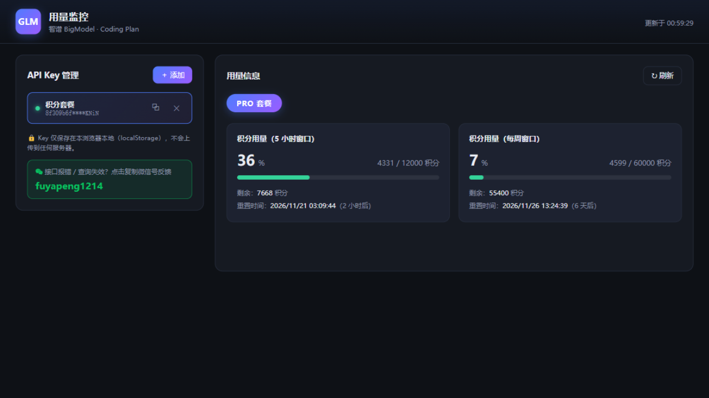
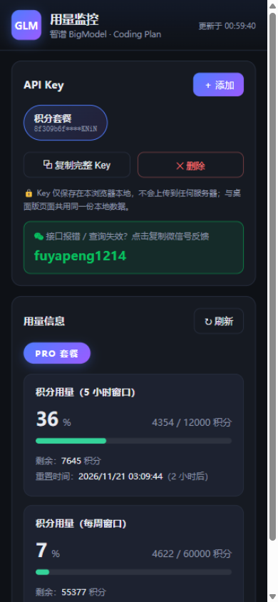

# GLM Coding Plan 用量查询面板

> **免责声明**：本项目为非官方第三方工具，与智谱（Zhipu AI / BigModel）无任何关联；所用接口可能随官方改版失效。请使用自己的 API Key，并妥善保管。

查询智谱 GLM Coding Plan 用量：Token / 积分 / MCP 调用配额，支持多 Key 管理、删除二次确认、一键复制完整 Key。

**纯静态网页，无后端、无数据库**——浏览器直连智谱接口，API Key 仅存在自己浏览器的 localStorage 里，不上传任何服务器。

## 在线预览

- 桌面版：<https://glm.usage.fuyapeng.com/>
- 手机版：<https://glm.usage.fuyapeng.com/h5>

打开后点「＋ 添加」填入你自己的 API Key 即可查询。

## 效果预览

**桌面版**（`index.html`）



**手机版**（`h5.html`）



## 部署（宝塔 3 步）

1. 宝塔 → 网站 → 添加站点：PHP 版本选「**纯静态**」，不创建数据库（建议顺手申请 SSL）
2. 把仓库里的 **4 个文件**（`index.html`、`style.css`、`app.js`、`h5.html`）上传到站点根目录
3. 访问你的域名，点「＋ 添加」粘贴 API Key（在 [bigmodel.cn 控制台](https://bigmodel.cn) 获取）

任何能放静态文件的环境都可以（Nginx / Caddy / GitHub Pages 等）。手机访问 `/h5.html` 即手机版。

## 没有服务器？本地直接用

下载本仓库（Code → **Download ZIP**），解压后**直接双击** `index.html`（桌面版）或 `h5.html`（手机版）就能在浏览器里使用，无需安装任何环境。

- 推荐使用 Chrome / Edge 等现代浏览器（微信、QQ 内置浏览器无法打开本地文件）
- Key 同样只存在浏览器的 localStorage 里，不上传任何服务器
- 注意：以本地方式打开时（`file://`），同一浏览器的所有本地页面共用同一份存储，请勿在来历不明的本地网页旁保存 Key

## 常见问题

**Key 安全吗？**
Key 只存你浏览器的 localStorage，仅用于直连智谱接口查询自己账号的用量；换浏览器或设备需重新添加。

**想给页面加访问密码？**
宝塔站点设置 →「密码访问」即可。

**接口失效 / 跨域被收紧？**
加一层 Nginx 反向代理（站点配置文件里加）：

```nginx
location /api/quota/ {
    proxy_pass https://open.bigmodel.cn/api/monitor/usage/quota/limit;
    proxy_set_header Host open.bigmodel.cn;
    proxy_ssl_server_name on;
}
```

然后把 `app.js` 第一行的 `API_URL` 改成 `"/api/quota/"`（`h5.html` 内的 `API_URL` 同理）。

## 问题反馈

官方接口可能随时改版导致查询失败，如遇页面报错、接口失效，请及时反馈：

- **微信**：`fuyapeng1214`（添加请备注「glm-usage」）
- 也可在本仓库提交 [Issues](https://github.com/fuyapeng123456/glm-usage/issues)

收到反馈后会尽快适配更新。
